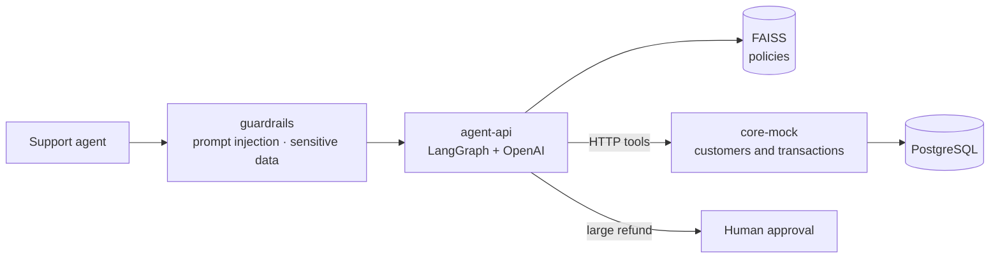

# Fintech Claims Copilot

AI assistant for customer support agents at **Lumen**, a fictional digital wallet. The agent pastes
the customer's claim; the copilot classifies it, retrieves the applicable policy, checks the
customer's transactions and proposes a reply with the action to take. When the action is risky
(a large refund, possible fraud), it stops and asks for human approval.

> Portfolio project, work in progress. All data, customers and policies are made up.
> The initial specification is in [docs/PRD.md](docs/PRD.md).

## Architecture



| Service | What it does | Stack |
|---|---|---|
| `core-mock` | Wallet core API: customers, transactions and refund requests | FastAPI, SQLAlchemy, PostgreSQL |
| `agent-api` | RAG over policies and, from phase 2, the agent graph | FastAPI, FAISS, OpenAI, LangGraph |
| `guardrails` | Input and output validation (phase 3) | FastAPI, Pydantic |

Policies and claims are in Spanish (Lumen is an Argentine wallet); code and docs are in English.

## Design decisions

- **Section-level chunks that repeat the document title.** A short section ("Deadlines") loses
  context when retrieved alone; with the title in front, the chunk stands on its own.
- **Swappable embeddings.** In production, OpenAI `text-embedding-3-small`. In tests and CI, a
  deterministic lexical embedder that needs no network and spends no tokens.
- **The index records which model built it.** Querying an index with a different embeddings model
  silently returns garbage; here it fails explicitly and forces a rebuild.
- **Retrieval measured against a golden set.** `evals/retrieval_golden.jsonl` holds realistic claim
  queries with the expected policy; we measure hit@1, hit@3 and MRR. CI enforces a floor.
- **Sensitive data stays out of the API.** The core never returns the full national ID (DNI), only a masked one.
- **Approval limits live in the system, not the prompt.** `core-mock` decides that a refund above
  $50,000 stays pending, not the model: even a manipulated agent cannot skip it.
- **Purpose-built scenarios.** Customers `C0001`–`C0006` each carry a typical claim (duplicate
  charge, pending transfer, possible fraud, reversed QR payment, missing cashback, large refund)
  and are the basis for evaluating the agent.

## Running it

```bash
cp .env.example .env          # optional: Azure OpenAI or OpenAI credentials
docker compose up --build
```

- core-mock: http://localhost:8001/docs
- agent-api: http://localhost:8000/docs → try `POST /policies/search`

Without Docker, run each service on its own:

```bash
cd services/core-mock && pip install -r requirements-dev.txt && pytest -q && uvicorn app.main:app --port 8001
cd services/agent-api && pip install -r requirements-dev.txt && pytest -q && uvicorn app.main:app --port 8000
python -m evals.retrieval     # inside agent-api: retrieval metrics
```

## Roadmap

- [x] **Phase 1** — core-mock with data and scenarios, policies, RAG with FAISS, retrieval golden set, CI
- [ ] **Phase 2** — LangGraph agent: classification, tools against core-mock, human approval
- [ ] **Phase 3** — guardrails service, agent golden set and prompt-injection red team in CI
- [ ] **Phase 4** — pgvector and LLM tracing with Langfuse
- [ ] **Phase 5** — Azure deployment with Terraform, CD from GitHub Actions via OIDC
- [ ] **Phase 6** — Kubernetes manifests (kind), final eval results

---

**Author:** Ignacio Otranto · [LinkedIn](https://www.linkedin.com/in/ignacio-julian-otranto/) ·
[GitHub](https://github.com/Foquitos)
